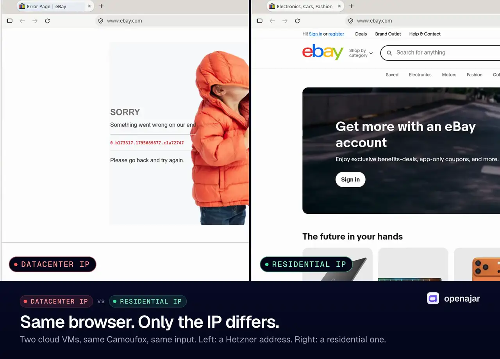

<p align="center">
  
</p>

<h1 align="center">openajar</h1>

<!-- mcp-name: com.openajar/openajar -->

<p align="center">
  <strong>A computer for your agent, with a browser, a terminal and a disk that stay.</strong><br>
  For Claude Code, Codex or any MCP agent, on machines in your own account. It saves when idle<br>
  and comes back in the next chat, signed in with logins from your vault the model never sees.
</p>

<p align="center">
  <a href="https://github.com/sabalys-ramunas/openajar/releases/latest"></a>
  <a href="https://github.com/sabalys-ramunas/openajar/actions/workflows/ci.yml"></a>
  <a href="LICENSE"></a>
  <a href="https://modelcontextprotocol.io"></a>
</p>

<p align="center">
  <a href="https://openajar.com">Website</a> ·
  <a href="#install">Install</a> ·
  <a href="#how-it-works">How it works</a> ·
  <a href="#signed-in-without-showing-a-password">Logins</a> ·
  <a href="#a-browser-the-web-lets-in">Browser</a> ·
  <a href="#what-it-costs">Costs</a> ·
  <a href="#safe-by-default">Safety</a> ·
  <a href="#faq">FAQ</a> ·
  <a href="docs/LOCAL.md">Docs</a>
</p>

<br>

<p align="center">
  
</p>

<picture>
  <source media="(prefers-color-scheme: dark)" srcset="https://raw.githubusercontent.com/sabalys-ramunas/openajar/main/assets/readme/how-it-works-dark.svg">
  
</picture>

> openajar was called agentos until November 2026 (legacy-name). Your setup keeps working: see
> [the names that stay](docs/LEGACY-NAMES.md) and run the installer again to upgrade.

## Is it for you?

openajar is for people who already use an agent (**Claude Code**, **Codex**, **T3 Code** or any MCP
client) and want it to have a computer of its own, one that is still there tomorrow:

- ✅ **A computer that stays.** Its installs, its branch, its dev server and its browser are there
  in the next chat. It saves itself when idle, so a quiet computer costs cents a month.
- ✅ **A browser it can stay signed in to.** It opens the accounts it works with (a dashboard, an
  admin page, a test shop) and acts there when the work needs it. Logins come from your own vault,
  and the model never sees them.
- ✅ **Run the app and check it in a real browser**, instead of saying it should work.
- ✅ **Desktop apps too, not only web pages.** It can open a program on its machine's desktop and use
  it with a real pointer and keyboard, while you watch.
- ✅ **Keep your laptop out of it.** Installs, builds, Docker and dev servers run on the machine,
  and no key sits there.
- ✅ **One computer per agent.** Several agents work at once, each on its own machine, so they never
  fight over ports, branches, cookies or `node_modules`.
- ✅ **Use its own shell on the machine**: `ssh openajar-<id>`, `rsync` and `scp`, as if it were local.

It is not another agent, chat or IDE. Your agent stays where it is, and openajar gives it a computer.

## Install

One command on macOS or Linux. It installs the latest release, then walks you through setup in the
terminal.

```sh
curl -fsSL https://openajar.com/install.sh | sh
```

Setup takes about five minutes: paste a Hetzner Cloud token (or use Docker), reuse your GitHub
login, and it connects Claude Code and Codex for you (and `ssh` to your agents' machines). Every step
can be skipped and changed later.

<p align="center">
  
</p>

> [!TIP]
> **Nothing bills until an agent opens a VM.** The service on your laptop is free and idle until
> then, and setup puts a monthly cap on VMs (10 EUR unless you choose another).

<details>
<summary><b>What you need</b></summary>

<br>

- macOS or Linux, with `git`
- Claude Code, Codex or T3 Code
- For the VMs, one of:
  - a [Hetzner Cloud](https://www.hetzner.com/cloud) account (about 0.011 EUR an hour while a VM is
    open). Make a project just for openajar: its token can delete any server in that project.
  - Docker running on your computer (free, less isolated)
- Optional: the [GitHub CLI](https://cli.github.com) (`gh`), so setup can reuse your login for
  private repositories

The installer puts `uv` and `openajar` in `~/.local/bin`, never asks for `sudo`, and is safe to run
again: it updates openajar in place, and restarts the local service when it runs, so it runs the new
version on the same port. To install a branch or an older release, set `OPENAJAR_GIT_REF`
(for example `OPENAJAR_GIT_REF=v0.5.3`).

<!-- legacy-name: begin (the old name, for people upgrading from it) -->
Coming from agentos 0.3 or 0.4? Run the same install line. It replaces the `agentos` command with
`openajar` and keeps your setup, environments and saves where they are.
<!-- legacy-name: end -->

</details>

### Then ask your agent

Start a new Claude Code or Codex session and say:

> Work in openajar on github.com/you/app: fix the failing checkout test, show me the page working,
> and open a pull request.

The agent opens its computer, gives you a **live view link** to watch its screen, and comes back
with a screenshot and the pull request link. You can take over at any time.

## How it works

1. **Your agent asks for its computer** when the task needs one. openajar rents a VM in your own
   account (Hetzner or Morph) or starts a Docker container, clones your repository into it and
   starts a browser there: [Camoufox](https://camoufox.com), a Firefox build that sites take for a
   person's browser ([more](#a-browser-the-web-lets-in)).
2. **The agent works on it like on its own laptop.** It edits files, runs the tests in its
   terminal, starts the dev server and opens the page in its browser, where `localhost` is the
   machine. It can open a program on the machine's desktop (an app that is not a web page) and use it
   with a real pointer and keyboard. It can also use its own shell: `ssh openajar-<id>`, `rsync` and
   `scp`. Dev servers keep running when openajar restarts or updates.
3. **It signs in when it needs to.** On a sign-in page it asks openajar, which types a login you
   chose from your vault into its browser. The model never sees the password.
4. **It shows you the result**: screenshots and videos kept as proof, and a pushed branch with its
   pull request. Pushes go through openajar, so the machine never holds your key.
5. **It closes when done, and stays.** When the task is done the agent closes its computer: the whole
   machine is saved and the VM deleted, so it costs cents a month (a single-use one is just deleted).
   The same happens when it goes idle. The next chat that asks for it by its title gets it back: in
   seconds on Morph, in about a minute on Hetzner.
6. **A machine that dies is noticed.** If its container or server stops outside openajar (killed,
   powered off, deleted), openajar asks the provider, says so in every tool and in the web app, and
   opening the same title again starts a fresh machine, from its last save when there is one.

The thinking stays on your laptop, in the agent you already use. openajar rents the machines in
your account, and bills you nothing of its own.

## Keep it and come back

Each computer has a title. Say *"continue the checkout fix in openajar"* in any new chat, and the
agent gets the same machine back: the branch, the files, `node_modules`, Docker volumes, the dev
server and the browser's sign-ins, plus the note the last agent left.

| | Good for | While nobody uses it |
|:--|:--|:--|
| 💾 **Saves when idle** (the default) | a computer that stays: work that spans days, accounts it stays signed in to | cents a month: the machine is saved and the VM deleted, back in seconds on Morph or about a minute on Hetzner |
| 🧹 **Single use** | a quick fix: work, push, done | nothing: the VM is deleted |
| ⚡ **Kept running** | a machine that is always on | billed every hour (about 7.80 EUR a month), and only after you allow it |

Setup offers saves when idle first. The agent asks for single use only for a one-off fix, and never
keeps one running unless you asked for it.

## Signed in, without showing a password

An agent's computer can stay signed in to the accounts it works with: a staging dashboard, an
admin page, a test account. It does not post or click for you on a schedule. It opens the account
when the work needs it, like you would.

You choose which logins from your vault a computer may use, by its title, its repository or all of
them (the password comes from a hidden prompt, never the command line):

```sh
openajar environments login add admin.example.com --title "Shop admin"   # or --repo me/shop, or --all
```

When the agent reaches a sign-in page, it calls the login tool. openajar types the stored login into
that computer's browser, and the model never sees it. If the site signs it out later, the agent signs
in again the same way, without asking you, or you do it from your laptop:
`openajar environments login "Shop admin" admin.example.com`. Nothing else in your vault reaches the
machine.

## A browser the web lets in

The agent's browser is [Camoufox](https://camoufox.com), an open source build of Firefox made so
that a site sees an ordinary person's browser and not an automation tool. openajar runs it on the
agent's computer, on a real screen, and adds what a browser alone does not have:

- **A hand, not a script.** The pointer moves along curved paths at a person's speed, keys are held
  and released with a person's timing, and the wheel scrolls in notches. Over the connection to the
  machine the timing is corrected, so the page sees what was planned.
- **One device per computer.** Each computer keeps one browser fingerprint (its GPU, fonts, screen
  and the rest) through every restart, save and resume, so a site sees the same device come back
  with the same sign-ins.
- **Your own address.** A cloud machine goes out from a datacenter address, and many sites refuse
  those whatever the browser is. Give the browser a static residential proxy, or your own computer's
  connection, and it goes out from an internet provider's address instead.

The same browser from two addresses, recorded on two Hetzner VMs on 26 November 2026. Only the
address differs. [What it gets through](#what-it-gets-through), and what it does not, is below.

<p align="center">
  
</p>

### Add a proxy

```sh
openajar proxy add lt1 host:port:user:pass   # as your provider gives it
openajar proxy test lt1                      # its exit IP, country, timezone and the language the browser will use
```

That is the whole setup. Every computer opened after that takes one of your proxies for its browser
and keeps it, so a computer always comes back from the same address. With several proxies, each open
computer takes a different one. On a server node, add `--environments` and set `browser = "vm"`.
The details are in [docs/ENVIRONMENTS.md](docs/ENVIRONMENTS.md#the-browsers-proxy).

- **The location is matched for you.** Before each launch openajar asks where the proxy goes out
  and sets the browser to that place: its timezone and clock, its language and `Accept-Language`,
  its number and date formats, and the address WebRTC shows. It hands out no position, like a
  Firefox where nobody has answered the location prompt. A proxy in Lithuania gives a browser in
  Vilnius time that asks for Lithuanian, then English. There is nothing to configure. To keep one language wherever the proxy is, set `browser_language = "en-US"` in
  `environments.toml`.
- **The password stays with you.** The machine's browser only gets an address on its own loopback.
  openajar on your side logs in to the proxy, so an agent with a root shell on the machine cannot
  read the credentials.
- **It never goes out without it.** If the proxy is down or refuses the login, the browser does not
  start. It does not fall back to the datacenter address. Names are looked up by the proxy, and
  nothing of the browser leaves from the machine's own address.
- **Only the browser uses it.** apt, npm, git and the shell go out as before, so your proxy carries
  pages and not package downloads.

### Or use this computer's own connection

```sh
openajar proxy this-computer          # prints the address this computer goes out from now, and its country
openajar proxy this-computer --off    # stop
```

The browser on the agent's computer then goes out through the computer openajar runs on: your laptop,
at home. Sites see your home address, which has the reputation of a real household, and it costs
nothing. The browser's timezone and language are matched to it as for a proxy, and it never reaches
your home network or this computer's own services: only public sites.

What it costs you instead:

- **Your connection, twice.** Every page the agent loads comes down to this computer and goes up to
  the machine. Your upload speed is the limit, and video is heavy.
- **This computer has to be on.** It works only while this computer is on and online. openajar local
  saves the environments when it sleeps.
- **It is your household's address.** What an agent does on a site counts for your home, and a site
  that bans the agent bans your home.
- **One address for all.** Every environment shares it. For several agents that should each have their
  own address, a static residential proxy per environment is still the way.
- **It moves with you.** When the laptop changes network or a VPN is on, the address changes, and the
  browser's timezone and language follow it at the next launch.

### Which proxy, and what it costs

For one person's light use, this computer's own connection is free and good. For many agents, accounts
that live a long time, or a laptop that sleeps, use a **static residential proxy** (also sold as an ISP
proxy): one fixed address that belongs to an internet provider. It is the right kind for an agent's
computer for two reasons.

- **It is a real provider's address that stays.** Sign-ins, the fingerprint and the address all stay
  together, as they do for a person at home. A rotating pool changes the address between requests,
  which signs accounts out and looks like many people sharing one browser.
- **It is the cheap kind for browsing.** A static address is billed per address a month with the
  traffic included. A rotating pool is billed per gigabyte, and a browser that loads real pages with
  their images uses gigabytes.

As an example, [IPRoyal](https://iproyal.com/pricing/static-residential-proxies/) listed these prices
in November 2026 (check the page, prices change):

| | Price |
|:--|:--|
| A static residential proxy, 30 days | from **2.70 USD** per address, traffic included (fair use) |
| The same on a 90 day plan | from **2.40 USD** per address a month |
| A rotating residential pool, for comparison | from about **7 USD per GB** at 1 GB |

One address per computer that is open at the same time is enough: two agents at once need two, and
a computer that is saved needs none while it sleeps. Take an address in the country you want sites
to see, close to where your machines run, since a long way between the two shows up as delay. The
address matters as much as the browser: some sites keep lists of the ranges proxy sellers resell, so
if one address is refused where another works, ask your provider for a different one.

### What it gets through

Checked on 24 November 2026 from a Hetzner VM in Nuremberg (Camoufox 0.5.9, Firefox 158), through a
static residential proxy in Lithuania, with openajar's defaults:

| Check | Result |
|:--|:--|
| [BrowserScan](https://www.browserscan.net/bot-detection) | normal on every bot check; authenticity 100%, proxy: no; timezone and language match the address |
| [whoer.net](https://whoer.net) | disguise 100%; proxy: no, anonymizer: no, blacklist: no |
| [Fingerprint](https://fingerprint.com) playground | bot, tampering, virtual machine, VPN and proxy: not detected; suspect score 0 |
| [CreepJS](https://abrahamjuliot.github.io/creepjs/) | 0% headless, 0% stealth, 13% like headless |
| [bot.sannysoft.com](https://bot.sannysoft.com), [rebrowser bot detector](https://bot-detector.rebrowser.net), [deviceandbrowserinfo](https://deviceandbrowserinfo.com/are_you_a_bot), BotD | pass, not a bot |
| A shop behind DataDome and one behind PerimeterX | the page, no challenge |
| eBay: home, search, an item | works. From the machine's datacenter address, without a proxy: 403 on the home page (on 26 November a search link loaded after eBay's "Pardon Our Interruption" page) |
| Amazon: home, search, a product, a second search | works, four sessions out of four, arriving through the home page (and its "Continue shopping" button when it shows one) and its search box |
| Leaks: a packet capture on the machine while the browser worked | none: no DNS, WebRTC or QUIC from the machine's own address |
| The same address after 140 page loads, a browser restart, and a save and resume | yes |

**Cloudflare's check** ("Just a moment...", "Verify you are human") follows the address more than the
browser. Through one of the residential proxies it let the browser through by itself on Glassdoor and on a
Crunchbase company page. From the datacenter's address it showed its checkbox on Glassdoor and Indeed, and
an untouched Firefox on the same machine got the same checkbox on the same pages, as did stock Camoufox. The
browser waits on that page as a person does (up to 20 seconds) before it reports anything. When the check
still asks for its "Verify you are human" checkbox, the agent sees it in its snapshot and clicks it once, with
real input on the machine's screen: from the datacenter's address that one click let the browser through on
Glassdoor, Indeed and a Cloudflare test site, and through the residential proxy on Indeed. openajar never
solves an image puzzle (hCaptcha's, reCAPTCHA's) itself: without a solving service of yours (below), the agent
hands the browser to you. An account's browser gets the same: the checkbox's ref, the one click and
`browser_challenge`.

**Your own solving service**, if you want one. For a widget a click does not pass (Cloudflare Turnstile,
reCAPTCHA v2 and Enterprise v2, hCaptcha), `openajar solver add` plugs in a captcha-solving service you pay for: CapSolver,
2Captcha or Anti-Captcha built in, or any other through a command or a webhook. It is off until you add one,
with your key (kept on this computer). The service and what it costs are your choice. The agent reaches it only
through `browser_challenge`, which waits, clicks once, asks your service, then hands the browser to you, and
says which step ended it, in any browser, your accounts' included. It never sends Cloudflare's full-page check,
and every request is in `openajar solver log` with the cost the service reported.
[docs/ENVIRONMENTS.md](docs/ENVIRONMENTS.md#the-owners-solving-service) has the details.

What it does not get through, from the same runs:

- **A page opened cold by its deep link.** Amazon answered a search link with no cookies from these
  proxy addresses with an error page, from every browser we tried, stock Firefox and Chrome
  included. Arriving as a person does (the home page, then the site's own search) worked.
- **[Pixelscan](https://pixelscan.net)** reports "masking detected". It agrees on the location and
  finds no proxy and no automation.
- **A machine with no graphics card.** A cloud VM draws its pages in software, and a check that
  times the drawing can tell.
- **Lists of resold addresses.** Services that track proxy sellers labelled two of our three test
  addresses as a proxy, and one site refused an address outright. That is the address, not the
  browser.

A proxy is for reaching sites as an ordinary visitor. It does not make a site's rules stop applying:
mind its terms and its rate limits.

## What it costs

openajar itself is free and open source. You pay your VM provider directly, with your own account.

| | Price |
|:--|:--|
| A VM while it is open (Hetzner `cx23`: 2 CPU, 4 GB) | about **0.011 EUR an hour** |
| A task under an hour, from open to pull request | about **0.01 EUR** |
| A saved computer (about 4 GB) | about **0.05 EUR a month** |
| A computer kept running all month | about **7.80 EUR a month** |
| Docker on your own computer | **free** |
| A static residential proxy for the browser (optional, from a proxy provider) | from about **2.70 USD a month** per address ([more](#which-proxy-and-what-it-costs)) |

Setup sets limits that hold whatever an agent asks: **10 EUR a month, 4 hours per VM, 2 VMs at
once**. Change them any time with `openajar setup limits`. The agent sees the cost so far, and so do
you.

## Safe by default

- 🔑 **No keys on the machine.** No key, token or password reaches the machine unless you bind a
  login to it, and the model never sees one. Your GitHub and cloud tokens stay on your laptop. A
  push goes through openajar with a token for that one repository, which dies with the VM.
- 🔐 **Logins you choose.** A login you bind is typed into that computer's browser, so its browser
  holds that session. A computer gets no other login.
- 🌿 **Your branches are safe.** The agent pushes new branches. It never deletes or rewrites your
  default branch, protected branches, tags, or branches someone else pushed.
- 🧱 **Commands only on the VM.** The agent's commands run in its environment, never on your laptop.
- 🔒 **One chat per machine.** Each machine answers only the chat that opened it, so two agents never
  work on the same computer by accident.
- ✍️ **Commits are yours.** With your GitHub login saved, commits carry your GitHub name and noreply
  address, so they link to your account without showing your email.
- 👀 **You can always watch.** Every environment has a live view of its screen, and you can take
  over with one click: the agent's tools then stay off the screen. It is still the agent's computer,
  so sign in there only to accounts the agent is meant to use.
- 💶 **Hard limits.** Past the monthly cap, the time limit or the VM count, opening is refused.
- 🗑️ **Nothing left running.** An idle computer is saved and its VM deleted after an hour (a
  single-use one is deleted), and work that was never pushed gets a rescue save instead of being
  lost.

What this defends against, and what it does not: [docs/THREAT-MODEL.md](docs/THREAT-MODEL.md).

## Works with

| Agent | Setup |
|:--|:--|
| **Claude Code** | connected by `openajar setup` (or `openajar connect`) in every Claude Code profile on the computer (`~/.claude.json`, and each `CLAUDE_CONFIG_DIR`), with the openajar skills; open sessions see the tools after a restart |
| **Any shell** | `openajar call <tool> --arg key=value` runs any tool under your agents' grant and prints JSON; `openajar tools` lists them. For an agent whose session has not loaded the MCP tools, and for scripts |
| **Codex** | connected by `openajar setup` |
| **T3 Code** | nothing more: it uses Claude Code's and Codex's settings, and shows the live view in its preview pane |
| **Any MCP client** (Cursor, Claude Desktop, for example) | add a stdio server that runs `openajar mcp` (or `npx -y openajar`, or `uvx openajar mcp`); or by hand: Streamable HTTP at `http://127.0.0.1:7410/mcp`, with the token setup keeps for your agents |

For a client that starts a command, the server entry is the same everywhere:

```json
{ "mcpServers": { "openajar": { "command": "openajar", "args": ["mcp"] } } }
```

`openajar mcp` talks to openajar on your computer and starts its service when it is stopped. On a
computer where openajar is not set up yet, it still answers, and tells the agent (and you) what to run.
`npx -y openajar` does the same through the installed CLI, and says what to install when there is none.
It is also listed in the [MCP Registry](https://registry.modelcontextprotocol.io) as
`com.openajar/openajar`.

## The web app

The live view link shows the agent's computer as it is now: its desktop with the browser, a terminal
and any app the agent opened, and a violet pointer with the agent's name wherever it clicks, types or scrolls. Press **Take over**
to click and type yourself, and **Hand back** when you are done. A live view link shows everything
on that screen, the agent's commands and their output included, so share it as you would the
screen. The round record button saves what you see as a video on your computer, ready to share. It
is made in your browser and never uploaded.

<p align="center">
  
</p>

openajar has a web app at `http://127.0.0.1:7410/`. **Home** says in a sentence or two what your agents
are doing and shows each open computer's screen. **Needs you** holds what waits for your answer,
**Computers** lists your agents' environments (open, saved and closed, each with a picture of its
screen) and your own machines, and **What happened** tells what the agents did, in plain words. For a
business there are **Accounts**, **Jobs that repeat** and **Brand**; **Runs and checks** and **Site APIs**
appear for developers once they are used, and **Settings** is last. Each computer has a page with its
live screen, the proofs, a replay of what its browser did, the commands it ran, its pushed branches,
what it costs and how long it has left. A computer whose machine stopped says so in red, with what to
do. It is open source like the rest (Apache-2.0, in [web/](web/README.md)).

The one-line install includes the web app, as an option: `openajar setup` offers it (yes by default)
and downloads the copy built for your version, checked against its release's sha256. Running the
installer again updates it with openajar. To leave it out, answer no, or add it later with
`openajar web install` (`openajar web remove` takes it away). Without it, every computer still has
its live view link, and `openajar environments list` in the terminal.

<picture>
  <source media="(prefers-color-scheme: dark)" srcset="https://raw.githubusercontent.com/sabalys-ramunas/openajar/main/assets/readme/environments-dark.webp">
  
</picture>

<picture>
  <source media="(prefers-color-scheme: dark)" srcset="https://raw.githubusercontent.com/sabalys-ramunas/openajar/main/assets/readme/environment-dark.webp">
  
</picture>

The live view link works on its own, without the web app.

## FAQ

<details>
<summary><b>How is this different from running the agent on my laptop?</b></summary>

<br>

The agent still runs where it runs now. Only its work moves: the commands, the dev server and the
browser run on a computer of its own that holds none of your keys, and only the logins you bind to
it. So it can work without asking you at every step, several agents can work at once, and your
laptop stays free.

</details>

<details>
<summary><b>How is it different from Grok Bot or OpenAI Dots?</b></summary>

<br>

The idea is the same: an agent gets a computer of its own, with a browser, a terminal and files,
that stays between conversations. The difference is whose agent and whose machine. Those are hosted
agents: you use their agent, on computers they run. openajar is for the agent you already use
(Claude Code, Codex, T3 Code or any MCP client), on machines in your own account (Hetzner, Morph, or
Docker on your computer). Each agent or chat gets a computer of its own, not one shared box. Logins
come from your own vault and are typed in without the model seeing them, pushes go through a git
gateway so no key sits on the machine, and you set the limits on spend. It is open source, with no
openajar account in between.

</details>

<details>
<summary><b>How is it different from E2B, Daytona and other sandboxes?</b></summary>

<br>

Those are sandboxes for code your product runs: your code starts one through an SDK, runs
something in it and throws it away, so the next run starts from nothing. They fit when you build a
product that runs code for your users. openajar is a computer that stays and is signed in, for the
agent in your chat: the agent asks for it itself over MCP, and tomorrow it gets the same machine
back, with its installs, its branch, its dev server and its browser's sign-ins. You can watch that
browser live and take it over.

</details>

<details>
<summary><b>Is my code on the VM? Are my keys?</b></summary>

<br>

Your code is: the repository is cloned there, or the agent uploads its local checkout, so it can
work on it. A saved computer keeps that code in a snapshot in your own provider account until you
forget it. Your keys are not: no key, token or password reaches the machine unless you bind a login
to it, and the model never sees one. A login you bind is typed into that computer's browser, so its
browser holds that session, and a save keeps it.

</details>

<details>
<summary><b>Does my laptop need to stay on?</b></summary>

<br>

Yes, while an agent works. The agent runs on your laptop and reaches its computer through openajar
there. When the laptop sleeps, each computer is saved and its VM deleted (unless you keep one
running), so nothing bills overnight. A dev server on the VM keeps running while openajar restarts or updates. For
machines that keep working while you sleep, run openajar on a server (below).

</details>

<details>
<summary><b>Can it work on private repositories?</b></summary>

<br>

Yes. With your GitHub login saved in setup, it can clone and push any repository that login can
reach. Without one, the agent gives you a link to a page where you paste a token for that
repository. The token never goes through the chat, and the agent never sees it.

</details>

<details>
<summary><b>Which VM providers are supported?</b></summary>

<br>

Hetzner Cloud, Morph Cloud (machines start in about a second, and a saved environment pauses with
its memory, so it comes back in seconds with its dev server still running), and Docker on your own
computer. Each uses your own account. The provider layer (`openajar.vms`) is small, and more providers
are welcome.

</details>

<details>
<summary><b>How do I update or remove it?</b></summary>

<br>

<!-- legacy-name: begin (the old name, for people upgrading from it) -->
Update: run the install command again, also from agentos 0.3 or 0.4.
<!-- legacy-name: end -->
Remove: see [docs/LOCAL.md](docs/LOCAL.md#remove-it)
(forget the saves you no longer need first, so no snapshot stays in your Hetzner account).

</details>

## Run it on a server

<details>
<summary><b>Always on, without your laptop</b></summary>

<br>

A server keeps working while your laptop sleeps. It can also keep signed-in browsers for your own
accounts on the server itself, and run studio's page checks (`ui_check`). A node is a small Linux VPS (Ubuntu 22.04 or
later, or Debian 12). On the node:

```sh
git clone https://github.com/sabalys-ramunas/openajar openajar && cd openajar
sudo deploy/install-node.sh --systemd --user agentos --hardened
sudo openajar vm setup                      # paste the Hetzner token
sudo openajar vm image build dev            # the snapshot each VM boots from
sudo openajar environments setup            # says what is still missing
```

Then on your computer, with the node in `~/.ssh/config` as `mynode`:

```sh
curl -fsSL https://openajar.com/install.sh | sh
openajar connect mynode
```

`connect` registers the node in every Claude Code profile on your computer (the default
`~/.claude.json` and each `CLAUDE_CONFIG_DIR` folder, such as `~/.claude_work`), replaces entries
from before the rename, and says which profiles it wrote. Claude Code loads MCP servers when a
session starts, so restart open sessions. Until then, any shell reaches the tools:
`openajar call <tool> --arg key=value` (`openajar tools` lists them). `openajar status --check`
names a profile whose entry points at an address that no longer answers.

Install, hardening, backups and upgrades: [deploy/README.md](deploy/README.md).

</details>

## For agents: the tools

<details>
<summary><b>What the agent gets</b>: an MCP server with a short everyday list</summary>

<br>

The default list is the loop of an agent on its own computer:

| Tool | What it does |
|:--|:--|
| `environment_open(title, repo, keep)` | opens a computer (or resumes the one with that title) with the repo in `/work/<name>` and a browser; it saves when idle unless `keep="none"`; returns `on`, which every later call carries |
| `environment()` | what is open and saved, the cost so far, ports, git, and the pull request link |
| `environment_close(note)` | the last call when the task is done: saved with a note for the next agent (a single-use one is deleted) |
| `environment_save(note)` | saves the whole machine now |
| `environment_upload()`, `environment_download(path)` | one-use links to send a local checkout up, or a file down to you |
| `terminal_exec`, `terminal_job_start`, `terminal_job_read(until_port=3000)`, `terminal_job_cancel` | run a command in its terminal; dev servers and long jobs, waiting until a port listens |
| `file_read`, `file_write`, `file_edit` | read (several files in one call), write and edit code |
| `ssh openajar-<id>` (local mode) | the agent's own shell on the machine, with `scp` and `rsync` |
| `browser_navigate`, `browser_snapshot`, `browser_act`, `browser_wait`, `browser_tabs`, `browser_dialog` | its browser, tabs and dialogs: read the page as an outline, act by reference |
| `browser_wait_handback` | waits while you have taken the browser over |
| `browser_screenshot(proof=...)`, `browser_record` | a screenshot or a video kept as proof, at desktop or phone width |
| `environment_pull_request(title)` | opens the pull request for the pushed branch, with its proofs |
| `environment_checkpoint(note)`, `environment_rollback` | an undo point before a risky step, and going back to it |
| `environment_port(port)` | a link for you to a dev server on the machine |
| `login`, `approval_wait` | signs in on the page with a login you bound to that computer (the model never sees it); waits for your answer to an approval |
| `tools_more`, `tools_call` | the other groups, loaded when the agent needs them |

The groups: `screen` (apps on its desktop that are not web pages: a picture of the screen and its
windows, real clicks, keys and typing, starting an app), `accounts` (driving your own signed-in
account browsers on a server node: list, open, claim, live view, uploads), `browser` (a browser's
downloads, scrolling a feed),
`terminals` (terminals and services the node keeps, raw VMs, forgetting saves), `studio` (checking
a page you build), `devtools`, `control`, `vault`, `flows`, `workflows`, `mail`, `memory`,
`profiles` and more.

The other tools load in groups when the agent needs them: [docs/TOOLS.md](docs/TOOLS.md). If a
machine stops, every call that needs it answers `machine_gone`, and `environment_open` with the same
title replaces it with a fresh one. The skill that teaches an agent the loop:
[openajar-environment](src/openajar/client/skills/openajar-environment/SKILL.md).

</details>

## Status

> [!NOTE]
> **Alpha, at 0.7.0.** 0.5 gave the agent's computer a desktop you can watch and work with, and the
> new name. 0.6 gave its browser an address of your own: a static residential proxy or this computer's
> connection, with the proxy's credentials kept off the machine. 0.7 adds your own captcha-solving
> service, off until you add one.
> Computers that stay and their logins are new, and the tools may still change between minor versions:
> see the [changelog](CHANGELOG.md) and the [releases](https://github.com/sabalys-ramunas/openajar/releases).
> On a laptop there is no `ui_check` yet (it needs a server), and the laptop must be awake while a VM works.

## Docs

| | |
|:--|:--|
| [docs/LOCAL.md](docs/LOCAL.md) | openajar on your laptop: the service, sleep, costs, where tokens live |
| [docs/ENVIRONMENTS.md](docs/ENVIRONMENTS.md) | the agent's computer in depth: setup, keeping, limits, troubleshooting |
| [docs/TOOLS.md](docs/TOOLS.md), [docs/ERRORS.md](docs/ERRORS.md) | every MCP tool, every error code and its fix |
| [docs/GIT.md](docs/GIT.md) | how git works through openajar |
| [deploy/README.md](deploy/README.md) | running openajar on a server |
| [docs/THREAT-MODEL.md](docs/THREAT-MODEL.md) | what it defends against |
| [docs/ARCHITECTURE.md](docs/ARCHITECTURE.md), [docs/VISION.md](docs/VISION.md) | how it is built, and where it is going |
| [docs/DEVELOPING.md](docs/DEVELOPING.md) | the dev loop and the tests |

## Contributing

Issues and pull requests are welcome. [CONTRIBUTING.md](CONTRIBUTING.md) has the dev loop: no cloud
account needed (`uv run openajar dev up` and the unit tests run on a laptop). For a security
problem, see [SECURITY.md](SECURITY.md) and report it privately.

## License

Apache License 2.0: see [LICENSE](LICENSE) and [NOTICE](NOTICE).
